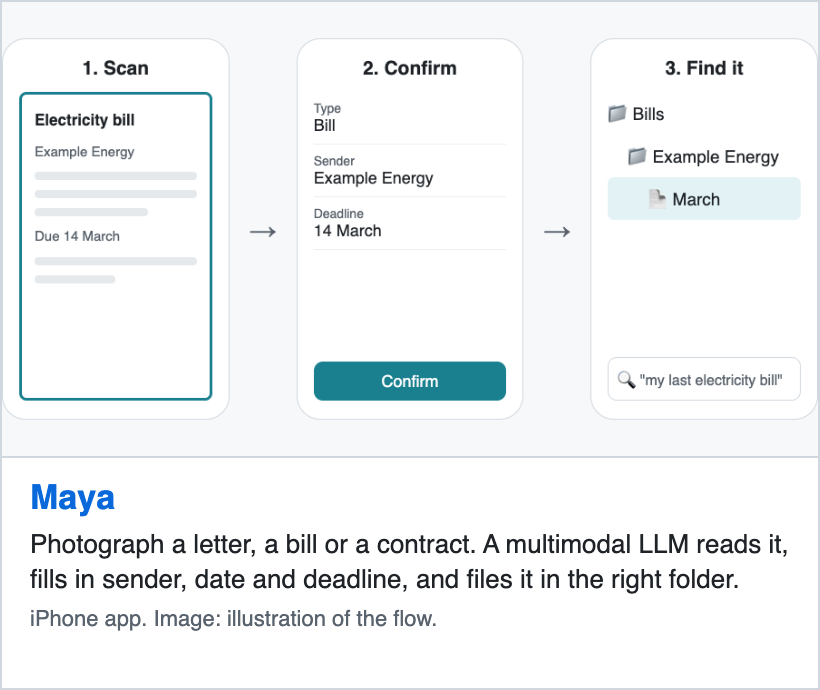
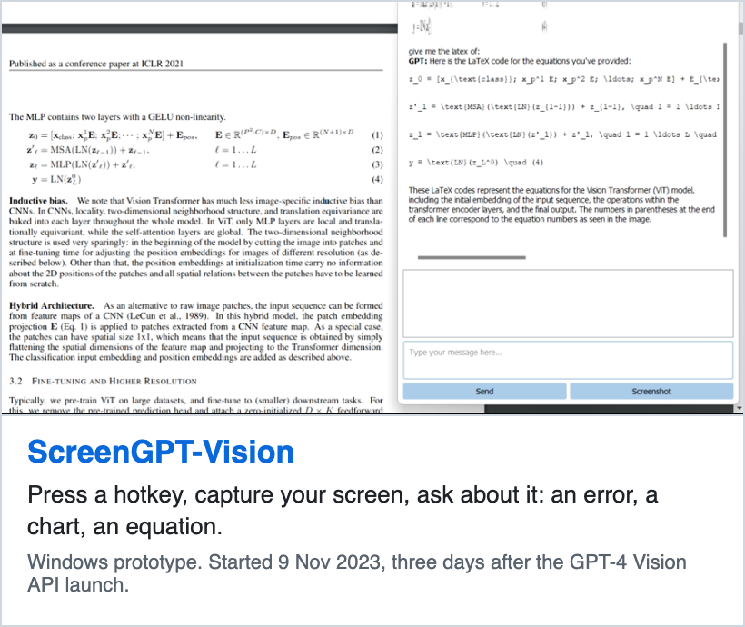
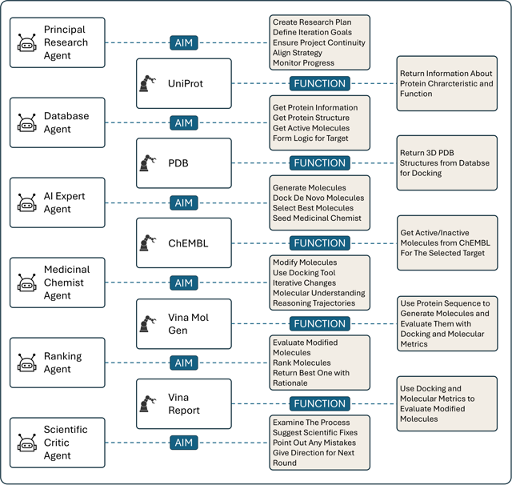
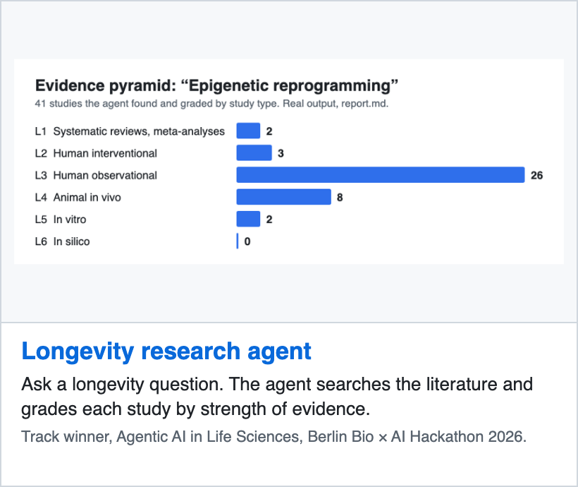
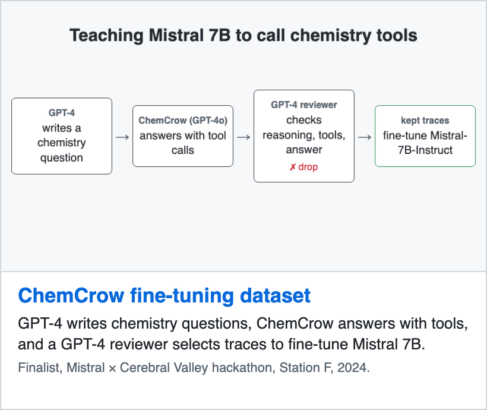
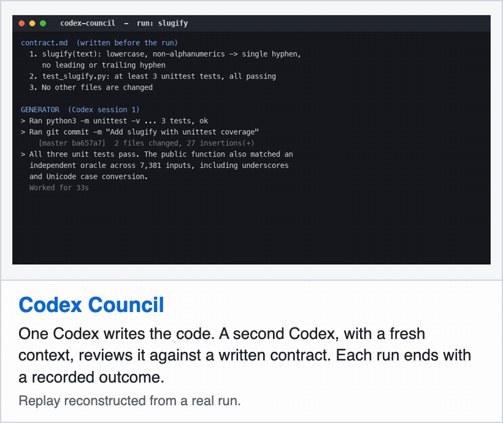
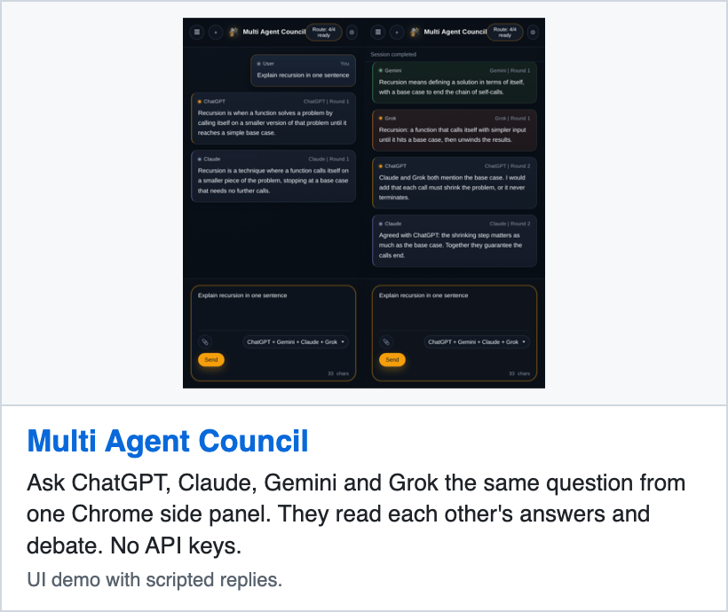

# Ahmet Celebi

**I build with each new AI capability, to make people more efficient.** Sometimes that means putting it in the hands of people who never read a model card. Sometimes it means pushing it further than it goes alone.

Co-founder and Chief AI Officer at [DeltaWave](https://deltawave.fr), Paris. I designed EVE, our AI co-scientist. A scientist asks whether a drug's binding is reproducible in docking; EVE finds the structures, runs the experiment, and returns an answer traced to its sources, in a secure environment the customer controls. First enterprise contract signed with a Nasdaq-listed company (deployment in progress). Second SPRIND Challenge award in 2026.

Before DeltaWave: data scientist at SESAMm and reciTAL. M2 in mathematics (M2MO, Université de Paris).

## Making new AI usable

<a href="https://github.com/AmT42/maya"><picture><source media="(prefers-color-scheme: dark)" srcset="assets/cards/maya-dark.png"></picture></a>
<a href="https://github.com/AmT42/ScreenGPT-Vision"><picture><source media="(prefers-color-scheme: dark)" srcset="assets/cards/screengpt-dark.png"></picture></a>

## Pushing AI further in science

**[An Auditable Agent Platform for Automated Molecular Optimisation](https://arxiv.org/abs/2508.03444)** · co-author · Aug 2025

Six agents optimise molecules against the AKT1 protein with docking tools. Every tool call is logged, so each molecule keeps a traceable history.

- With Claude 3.7 Sonnet, the multi-agent setup reached the best mean docking score: **−10.97 kcal/mol**, against −10.65 for the LLM alone and −9.72 for a single agent (lower means stronger predicted binding).
- Single-agent runs gave more drug-like molecules: 100% pass Lipinski's rule of five, against 56% for multi-agent.
- This paper studies the first version of our harness.

Figure: Ünlü, Rohr, Celebi et al., arXiv 2508.03444, CC BY-NC-SA 4.0.

 

<a href="https://github.com/AmT42/longevity-research-agent"><picture><source media="(prefers-color-scheme: dark)" srcset="assets/cards/longevity-dark.png"></picture></a>
<a href="https://github.com/AmT42/REaCT-FT-DATASET-TUTORIAL"><picture><source media="(prefers-color-scheme: dark)" srcset="assets/cards/chemcrow-dark.png"></picture></a>

## Working with coding agents

I build software with coding agents. I built these tools to make their work easier to inspect and review.

<a href="https://github.com/AmT42/codex-council"><picture><source media="(prefers-color-scheme: dark)" srcset="assets/cards/codex-council-dark.gif"></picture></a>
<a href="https://github.com/AmT42/agent-council-browser"><picture><source media="(prefers-color-scheme: dark)" srcset="assets/cards/agent-council-dark.png"></picture></a>

Earlier: [Q-learning maze generator](https://github.com/AmT42/q-learning-maze-generator) (2022), an RL agent that builds mazes. Write-up of the fine-tuning dataset: [Medium](https://medium.com/@ahmet_celebi/create-react-fine-tuning-dataset-for-mistral-7b-instruct-v0-3-d6556bab7c56).

## Open source

- [happier #499](https://github.com/happier-dev/happier/pull/499): retained-message submission fix (merged).
- [paper-qa #1302](https://github.com/Future-House/paper-qa/pull/1302): citation ingestion fix (merged).

---
[LinkedIn](https://www.linkedin.com/in/ahmet2109/) · ahmet_celebi@hotmail.fr
