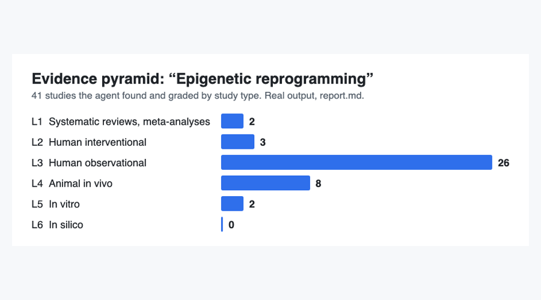
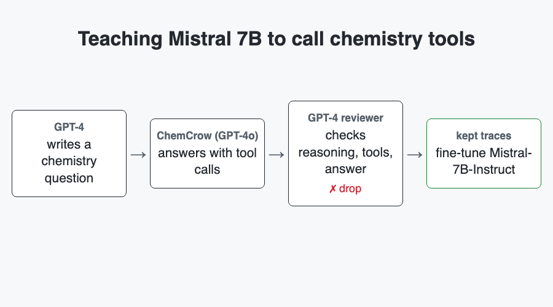
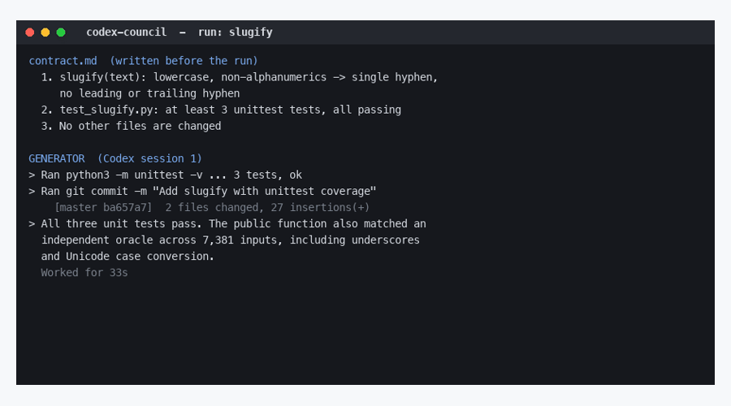
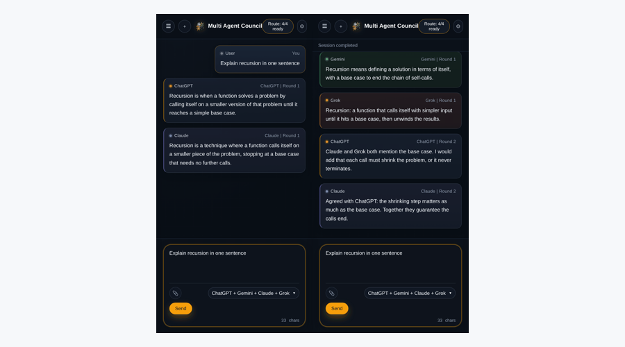
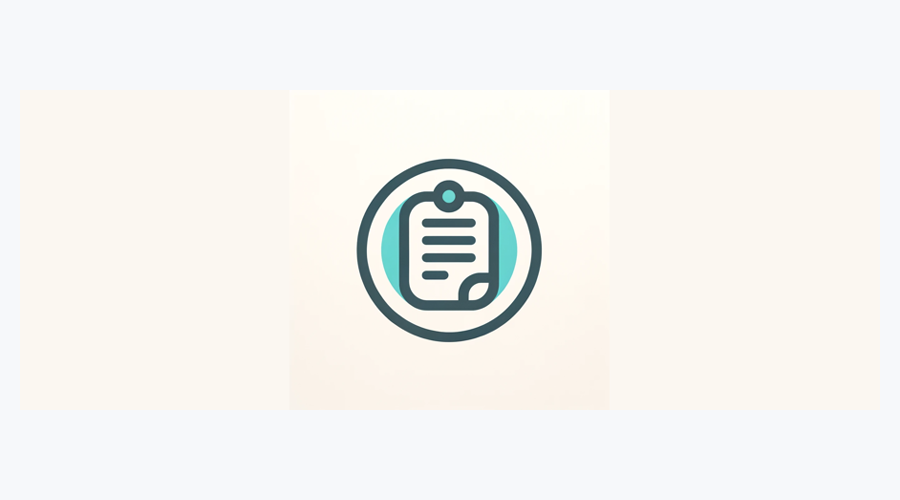
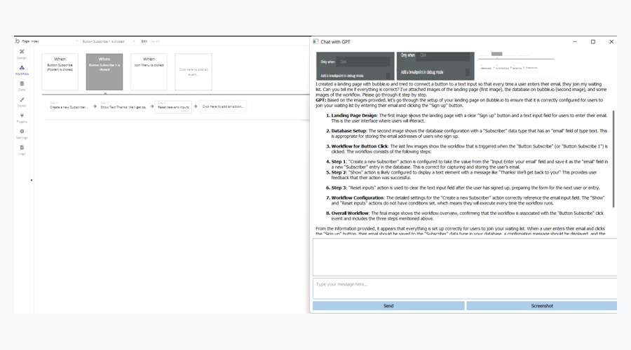

# Ahmet Celebi

**I design agent systems for drug discovery.** Co-founder and Chief AI Officer at [DeltaWave](https://deltawave.fr), Paris.

I designed eve, our agent harness for drug discovery: agent loop, tool calling, sub-agents, memory, context compaction, sandboxed code execution, and runs that survive a worker crash. First enterprise contract signed with a Nasdaq-listed company (deployment in progress). I design and verify; coding agents implement.

Before DeltaWave: data scientist at SESAMm and reciTAL. M2 in mathematics (M2MO, Université de Paris).

## Research

**[An Auditable Agent Platform for Automated Molecular Optimisation](https://arxiv.org/abs/2508.03444)** · co-author · Aug 2025

Six agents (principal researcher, database, AI expert, medicinal chemist, ranking, scientific critic) optimise molecules against the AKT1 protein with docking tools. Every tool call is logged, so each molecule keeps a traceable history of tool calls and molecular transformations.

- With Claude 3.7 Sonnet, the multi-agent setup reached the best mean docking score: **−10.97 kcal/mol**, against −10.65 for the LLM alone and −9.72 for a single agent (lower means stronger predicted binding).
- Single-agent runs gave more drug-like molecules: 100% pass Lipinski's rule of five, against 56% for multi-agent.
- This paper studies the first version of our harness.

Figure: Ünlü, Rohr, Celebi et al., arXiv 2508.03444, CC BY-NC-SA 4.0.

 

## Agents for science

<table>
<tr>
<td width="50%" valign="top"> <b><a href="https://github.com/AmT42/longevity-research-agent">Longevity agent</a></b> Track winner, Agentic AI in Life Sciences, Berlin Bio × AI Hackathon 2026 (17 teams across all tracks). The chart sorts the 41 studies of one real report by evidence level.</td>
<td width="50%" valign="top"> <b><a href="https://github.com/AmT42/REaCT-FT-DATASET-TUTORIAL">ChemCrow on Mistral 7B</a></b> Finalist, Mistral × Cerebral Valley hackathon, Station F, 2024. A synthetic dataset filtered by a GPT-4 reviewer. <a href="https://medium.com/@ahmet_celebi/create-react-fine-tuning-dataset-for-mistral-7b-instruct-v0-3-d6556bab7c56">Write-up</a>.</td>
</tr>
</table>

## Tools for working with coding agents

<table>
<tr>
<td width="50%" valign="top"> <b><a href="https://github.com/AmT42/codex-council">Codex Council</a></b> One agent codes, a fresh reviewer agent checks each round against the contract. Replay reconstructed from a real run.</td>
<td width="50%" valign="top"> <b><a href="https://github.com/AmT42/agent-council-browser">Multi Agent Council</a></b> A Chrome extension: ChatGPT, Claude, Gemini and Grok debate in their own tabs. UI demo with scripted replies.</td>
</tr>
</table>

## Apps

<table>
<tr>
<td width="50%" valign="top"> <b><a href="https://github.com/AmT42/maya">Maya</a></b> An iPhone app: an LLM reads your scans and files them.</td>
<td width="50%" valign="top"> <b><a href="https://github.com/AmT42/ScreenGPT-Vision">ScreenGPT-Vision</a></b> A desktop app built on the GPT-4 Vision API in November 2023.</td>
</tr>
</table>

Earlier: [Q-learning maze generator](https://github.com/AmT42/q-learning-maze-generator) (2022), an RL agent that builds mazes.

## Open source

- [happier #499](https://github.com/happier-dev/happier/pull/499): retained-message submission fix (merged).
- [paper-qa #1302](https://github.com/Future-House/paper-qa/pull/1302): citation ingestion fix (merged).

---

[LinkedIn](https://www.linkedin.com/in/ahmet-celebi-973b63197) · ahmet_celebi@hotmail.fr
